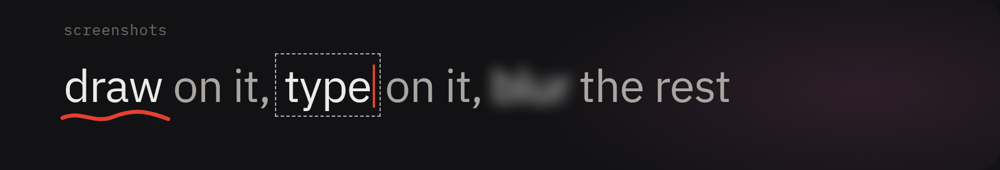
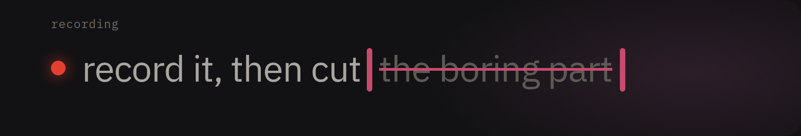
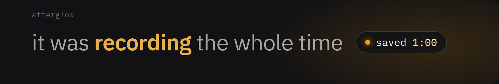

<p align="center"><picture><source media="(prefers-color-scheme: light)" srcset="docs/readme/hero-light.png"></picture></p>

<p align="center">
screenshots and screen recording for windows, living in your tray<br>
<a href="https://github.com/nitreojs/glint/releases/latest"><b>download</b></a>
</p>

<br>

<picture><source media="(prefers-color-scheme: light)" srcset="docs/readme/head-screenshots-light.png"></picture>

`ctrl+printscreen`, drag over the thing, done<br>
or don't stop there: pens, arrows, boxes, numbered steps, text in any font you have, blur and pixelate for the stuff nobody should see<br>
the toolbar is yours: hide what you never use, put the rest in your order and groups, give them your keys<br>
draw anywhere on the frozen screen, even outside the selection; resize the selection to reframe it, with the magnifier beside the moving edge when enabled<br>
only the selected area is copied or saved


<br>

<picture><source media="(prefers-color-scheme: light)" srcset="docs/readme/head-grab-light.png"></picture>

grab any piece of the screen and drop it right on top, as big as you want<br>
drag its corners to resize freely; hold `shift` to keep its proportions<br>
paste pictures in with `ctrl+v`, pin the result above every window

<p align="center"></p>

<br>

<picture><source media="(prefers-color-scheme: light)" srcset="docs/readme/head-recording-light.png"></picture>

`ctrl+alt+printscreen`, pick a region or a window, go<br>
it records straight off the gpu with your mic and system sound, and can show your clicks and keys

then trim it, crop it, mute a track, squeeze it under a size<br>
long recordings show a quick thumbnail overview first, then fill in the detailed filmstrip. MP4 waveforms can load from audio data alone, without reading through the video. Recently viewed frames are reused when you scrub back to them<br>
park the playhead and drag either trim edge to its line to cut there; hold ctrl to bypass snapping<br>
press **S** at each end of a section, then right-click that piece in the thumbnail strip to remove or restore it<br>
hold **Shift** and drag either edge of a kept piece in the thumbnail strip to stretch or shorten its playback without trimming the source; the opposite edge stays put as you drag, and the current speed and duration appear beside the drag. Audio pitch follows the speed<br>
double-click inside a retimed piece to restore it to **1×**; **Ctrl+Z** restores its previous speed. The focused piece stays at normal brightness while other kept pieces dim by 25%. If the whole timeline was visible before a speed drag, it eases to fit the new duration after release<br>
park the playhead inside a kept piece to target it at either cut shared with another kept piece; otherwise, drag from the kept side you want<br>
hover over a split for a hint: right-click the line to merge two kept pieces at the same speed; restore any removed piece first<br>
removed pieces get a moving striped shade that fades in and out as you remove or restore them<br>
if nothing has to be re-encoded, it isn't: the cut is lossless, starts on the exact frame, and glint says so<br>
when combining sound, tracks that end early fall silent while the rest of the clip continues

after saving, drag the thumbnail or filename into a chat, or click it and paste with **Ctrl+V**. After 8 seconds idle, the card becomes a thumbnail beside **Save** with the same drag and copy actions. It stays until the next successful export or you close the clip. Hover for size details; the card’s folder icon still shows the file in Explorer.

in **settings → recording → after trimming**, keep both files (the default), keep only the trimmed copy, or ask each time<br>
originals go to the recycle bin when the editor closes, only after an edited copy has saved successfully and still exists; unsaved changes or a later failed/cancelled export keep the original


<br>

<picture><source media="(prefers-color-scheme: light)" srcset="docs/readme/head-gallery-light.png"></picture>

every shot and clip in one place<br>
hover to play, search by app or game or day, drag straight into a chat
<br>under **filter → video edits**, choose **untrimmed** for original videos or **trimmed** for edited exports<br>
**Shift+click** videos to open separate Glint editors in the background without leaving the gallery


<br>

<picture><source media="(prefers-color-scheme: light)" srcset="docs/readme/head-afterglow-light.png"></picture>

**afterglow** is glint's little sibling for games: it keeps the last minute of your screen and sound, and `alt+f10` saves it<br>
clips open in glint's editor, and in deadlock it even knows when you got a kill, and can clip it by itself (beta)
<br>
replay saves write MP4 directly without waiting for Windows Media Foundation to finalize the file. If a save stalls, afterglow reports a timeout and allows another save after 90 seconds; any `.mp4.part` left behind is kept separate from finished clips

In either tray menu, **diagnostics** shows the current and previous run. Search for a clip name,
filter by event type or level, or pick an error and show the surrounding events. Replay saves
explain whether the clip was saved, shortened by the memory cap, or not reported in time.
**Open raw log** still opens the complete file in Notepad.

### get it

grab the exe from [releases](https://github.com/nitreojs/glint/releases/latest) and run it, it lands in the tray and updates itself from then on

<details>
<summary>building it yourself</summary>

```
cargo build --release -p glint
```

needs rust and windows, the exe ends up in `target/release/glint.exe`
</details>
