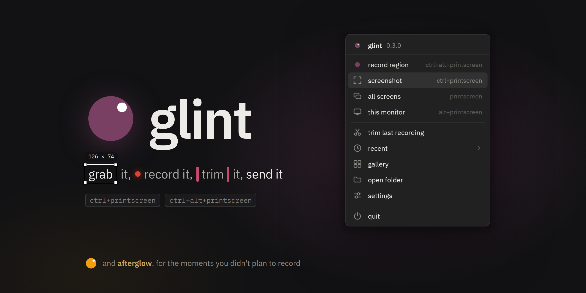
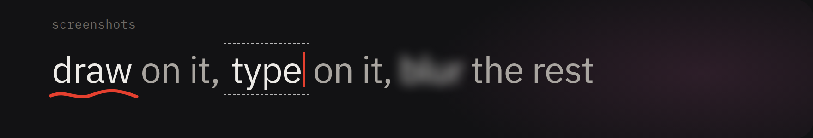
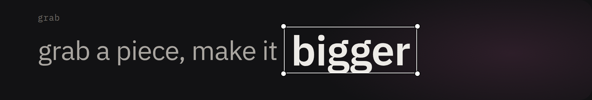
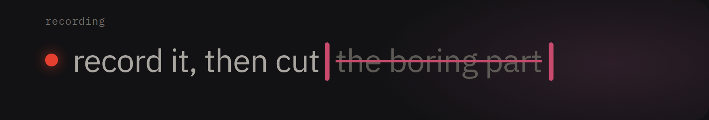
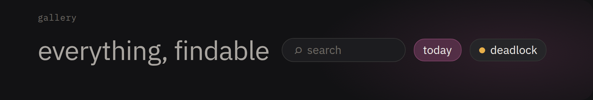
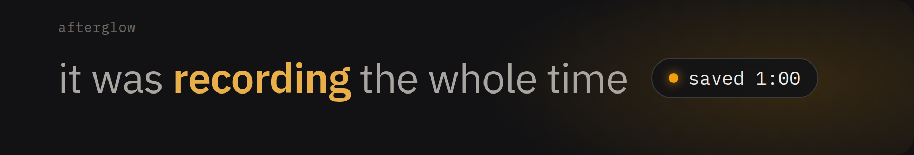

<p align="center"><picture><source media="(prefers-color-scheme: light)" srcset="docs/readme/hero-light.png"></picture></p>

<p align="center">
screenshots and screen recording for windows, living in your tray<br>
<a href="https://github.com/nitreojs/glint/releases/latest"><b>download</b></a>
</p>

<br>

<picture><source media="(prefers-color-scheme: light)" srcset="docs/readme/head-screenshots-light.png"></picture>

`ctrl+printscreen`, drag over the thing, done<br>
or don't stop there: pens, arrows, boxes, numbered steps, text in any font you have, blur and pixelate for the stuff nobody should see


<br>

<picture><source media="(prefers-color-scheme: light)" srcset="docs/readme/head-grab-light.png"></picture>

grab any piece of the screen and drop it right on top, as big as you want<br>
paste pictures in with `ctrl+v`, pin the result above every window

<p align="center"></p>

<br>

<picture><source media="(prefers-color-scheme: light)" srcset="docs/readme/head-recording-light.png"></picture>

`ctrl+alt+printscreen`, pick a region or a window, go<br>
it records straight off the gpu with your mic and system sound, and can show your clicks and keys

then trim it, crop it, mute a track, squeeze it under a size<br>
if nothing has to be re-encoded, it isn't: the cut is lossless and glint says so


<br>

<picture><source media="(prefers-color-scheme: light)" srcset="docs/readme/head-gallery-light.png"></picture>

every shot and clip in one place<br>
hover to play, search by app or game or day, drag straight into a chat


<br>

<picture><source media="(prefers-color-scheme: light)" srcset="docs/readme/head-afterglow-light.png"></picture>

**afterglow** is glint's little sibling for games: it keeps the last minute of your screen and sound, and `alt+f10` saves it<br>
clips open in glint's editor, and in deadlock it even knows when you got a kill (beta)

### get it

grab the exe from [releases](https://github.com/nitreojs/glint/releases/latest) and run it, it lands in the tray and updates itself from then on

<details>
<summary>building it yourself</summary>

```
cargo build --release -p glint
```

needs rust and windows, the exe ends up in `target/release/glint.exe`
</details>
