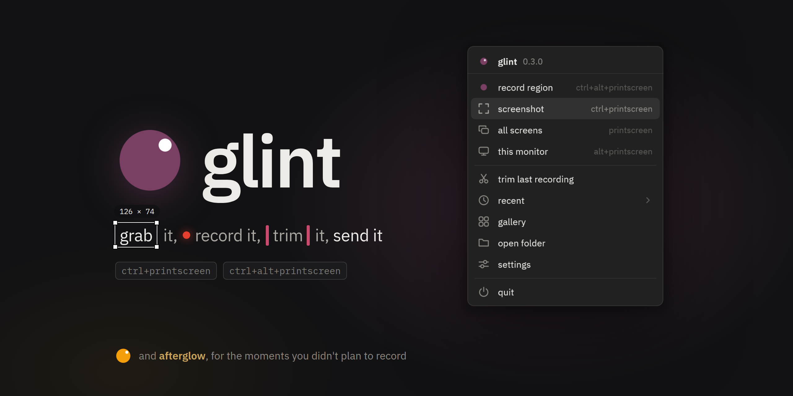
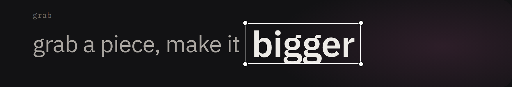
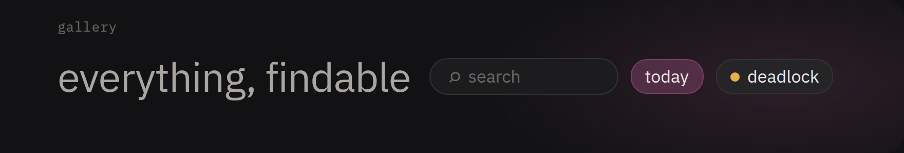

# glint

screenshots and screen recording for windows, living in your tray

**[download glint](https://github.com/nitreojs/glint/releases/latest)** · [afterglow](#afterglow)

run the exe and look in your tray. glint checks for updates from there.

<p align="center"><picture><source media="(prefers-color-scheme: light)" srcset="docs/readme/hero-light.png"></picture></p>

## screenshots

<picture><source media="(prefers-color-scheme: light)" srcset="docs/readme/head-screenshots-light.png"></picture>

`ctrl+printscreen`, drag over the thing, done.

or don't stop there: pens, arrows, boxes, numbered steps, text in any font you have, blur and pixelate for the stuff nobody should see.

- make the toolbar yours: hide tools, move them around, give them your keys
- draw outside the selection and resize it to reframe. only what's inside gets copied or saved. turn on the magnifier if you need it


## pin a grab

<picture><source media="(prefers-color-scheme: light)" srcset="docs/readme/head-grab-light.png"></picture>

grab a piece of the screen or paste a picture with `ctrl+v`, then pin it above every window. drag a corner to resize; hold `shift` to keep its shape.

<details>
<summary>see it in action</summary>


</details>

## recording

<picture><source media="(prefers-color-scheme: light)" srcset="docs/readme/head-recording-light.png"></picture>

`ctrl+alt+printscreen`, pick a region or a window, go. it records straight off the gpu with your mic and system sound. it can show your clicks and keys, too.

then trim it, crop it, mute a track, squeeze it under a size. use `←` and `→` to go frame by frame.

<details>
<summary>the timeline, one move at a time</summary>

- **trim** — drag an edge to the playhead to snap there. hold `ctrl` to bypass snapping.
- **cut a piece out** — press `s` at both ends, then right-click the piece in the thumbnail strip to remove or restore it.
- **change speed** — `shift+drag` an edge of a kept piece. the other edge stays put, and the clip keeps the same source frames. speed and duration show as you drag; pitch follows speed.
- **pick a side at a split** — park the playhead in the piece you want, or drag from that side of the split.
- **undo a stretch or join two pieces** — double-click a retimed piece to go back to `1×`; `ctrl+z` brings its speed back. right-click a split to merge two kept pieces at the same speed.

glint and afterglow collect waveforms and an overview while recording. for other videos, the editor draws waveforms as the audio comes in. previews are cached on your pc, not in the video.

</details>

<details>
<summary>save it, send it, keep the original (or don't)</summary>

- if nothing needs re-encoding, glint says so and exports losslessly. when sound is combined, tracks that end early go quiet while the clip keeps playing.
- drag the saved thumbnail or filename into a chat, or click it and paste with `ctrl+v`. after eight seconds idle, the card shrinks beside **save**, but still works the same way. hover for size or click the folder to show it in explorer.
- in **settings → recording → after trimming**, keep both files (the default), keep only the trimmed copy, or ask each time. glint only recycles the original on editor close if the edited copy saved successfully and still exists. unsaved edits or a later failed or cancelled export keep the original.

</details>


## gallery

<picture><source media="(prefers-color-scheme: light)" srcset="docs/readme/head-gallery-light.png"></picture>

every shot and clip in one place. hover to play, search by app or game or day, drag straight into a chat.

- under **filter → video edits**, pick **untrimmed** for originals or **trimmed** for exports
- `shift+click` a video to open a separate editor without leaving the gallery


## afterglow

<picture><source media="(prefers-color-scheme: light)" srcset="docs/readme/head-afterglow-light.png"></picture>

glint's little sibling for games. it keeps the last minute of your screen and sound; `alt+f10` saves it. clips open in glint's editor. in deadlock it can clip your kills for you (beta).

**[download afterglow](https://github.com/nitreojs/glint/releases?q=afterglow)**

<details>
<summary>if a save gets stuck</summary>

open **diagnostics** from either tray menu to see the current or previous run. search for a clip, filter by event type or level, or select an error to see what happened around it. **open raw log** opens the whole thing in notepad.

afterglow writes mp4s directly. diagnostics says if a clip saved, was shortened by the memory cap, or timed out. if a save stalls, you can try again after 90 seconds. any `.mp4.part` stays separate from finished clips.

</details>

<details>
<summary>building it yourself</summary>

on windows with rust:

```sh
cargo build --release -p glint
```

the exe ends up in `target/release/glint.exe`. use `-p afterglow` to build afterglow instead.

</details>
